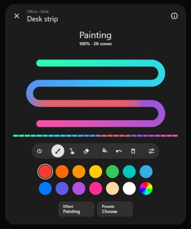
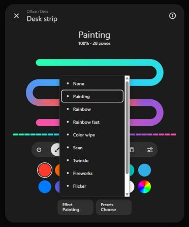
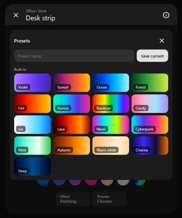

# ESPHome LED Painter

Paint an addressable LED strip with your finger from Home Assistant.

The project has two parts that work together:

- **`led_painter`** - an ESPHome external component. It adds a "Paint" effect to
  any addressable light, keeps the painted frame on the device and stretches it
  over the whole strip.
- **LED Painter card** - a Home Assistant dashboard card and dialog with a
  brush, smudge and eraser tools, a colour palette, presets and the usual light
  controls.

No extra integration is needed in Home Assistant: the card talks to the device
through a normal ESPHome action.

| Painting | Effects | Presets |
| --- | --- | --- |
|  |  |  |

## How it works

1. The card averages what you paint down to one colour per zone and calls the
   device's `paint` action with a string of `rrggbb` triplets.
2. The component stores the frame and the "Paint" effect draws it. The frame is
   interpolated to the real LED count, so the same data works on a 28-LED and a
   300-LED strip.
3. The frame is saved to flash a few seconds after the last change and restored
   on boot.
4. A diagnostic sensor reports the LED count, so the card knows how many zones
   the light has without any configuration.

## Install

### 1. ESPHome component

Add this to the device YAML (full example in [`examples/device.yaml`](examples/device.yaml)):

```yaml
external_components:
  - source: github://matiserv/esphome-led-painter
    components: [led_painter]

led_painter:
  id: painter

api:
  actions:
    - action: paint
      variables:
        colors: string
      then:
        - lambda: id(painter).set_hex(colors.c_str(), colors.size());

light:
  - platform: ...        # any addressable light
    effects:
      - led_painter:
```

Then install the firmware. The device gets a new effect called **Paint**, a
`Painter zones` sensor and an `esphome.<device>_paint` action.

[`tools/add_led_painter.py`](tools/add_led_painter.py) can add these entries to
existing YAML files for you:

```bash
python3 add_led_painter.py my-strip.yaml:light_id --github
```

### 2. Home Assistant card

With HACS: add this repository as a custom repository of type **Dashboard**,
install **LED Painter Card** and reload the browser.

By hand: copy [`dist/led-painter-card.js`](dist/led-painter-card.js) to
`/config/www/` and add `/local/led-painter-card.js` as a dashboard resource of
type *JavaScript module*.

## Use

Once the resource is loaded you do not have to add a card at all:

- choosing the **Paint** effect on a light opens the paint dialog;
- while a light is in the Paint effect, opening its details shows the paint
  dialog instead (the info button leads to the standard one).

You can also put the card on a dashboard:

```yaml
type: custom:led-painter-card
entity: light.led_strip
```

### Light groups

Point the card (or open the dialog) on a Home Assistant light group. The
painted strip is split between the members that have the Paint effect, in
proportion to their LED counts, and each member gets its own part.

### Card options

| Option | Default | Description |
| --- | --- | --- |
| `entity` | required | Light or light group. |
| `name` | entity name | Title shown on the card. |
| `rows` | `4` | Rows of the serpentine preview (1-8). |
| `led_count` | `60` | Zone count used only when the device does not report it. |
| `paint_effect` | `Paint` | Effect name, if you renamed it in ESPHome. |
| `paint_action` | `paint` | Name of the ESPHome action. |
| `members` | - | Map of `entity_id: weight` to override how a group is split. |
| `services` | - | Map of `entity_id: esphome_action` if the action cannot be found automatically. |

Presets you save and the last painting of each light are stored in your Home
Assistant user data, so they follow you between browsers and devices.

## Component options

```yaml
led_painter:
  id: painter
  restore: true            # save the frame to flash and restore it on boot
  zones:
    name: "Painter zones"  # diagnostic sensor with the LED count

light:
  - platform: ...
    effects:
      - led_painter:
          name: "Paint"    # effect name
          reverse: false   # paint from the other end of the strip
```

Use one `led_painter` entry per painted light. With several, give each its own
`id`, `zones` name and API action, and reference it from the effect with
`led_painter_id`.

## Remembering the last effect

ESPHome clears the effect when a light turns off, so after off/on the light
comes back with a plain colour. [`examples/device.yaml`](examples/device.yaml)
shows an optional `globals` + `interval` + `on_turn_on` block that restores the
last effect, including Paint.

## Limitations

- The card finds the device's action from the device name and the light's
  entity id. If you renamed things and it cannot find it, set `services`.
- The zones sensor is found by its entity id ending in `_painter_zones`.
- The dialog hooks into Home Assistant frontend events that are not a public
  API, so a major frontend update may require a card update.
- The effect list and the more-info replacement work on dashboards, where
  dashboard resources are loaded.

## Development

Open [`test/index.html`](test/index.html) through any static web server from
the repository root to try the card with a fake Home Assistant.

## License

MIT - see [LICENSE](LICENSE).
